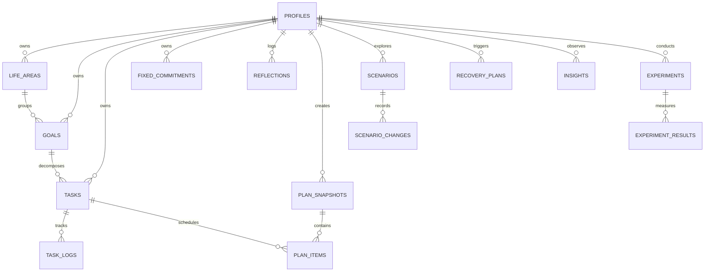

# LIFESYNC Database Schema & Security Design

## 1. Overview

LIFESYNC uses PostgreSQL (managed via Supabase) with UUID primary keys, foreign key constraints with cascade behaviors, strict domain check constraints, indexes for query performance, and Row Level Security (RLS) on all user-owned tables.

## 2. Entity Relationship Diagram (ERD)



## 3. Database Tables & Field Definitions

### `profiles`
- `id` (UUID, PK, references `auth.users(id)` ON DELETE CASCADE)
- `display_name` (TEXT, NOT NULL)
- `timezone` (TEXT, NOT NULL, DEFAULT 'UTC')
- `daily_available_minutes` (INTEGER, NOT NULL, DEFAULT 180, CHECK > 0)
- `planning_preferences` (JSONB, NOT NULL)
- `created_at`, `updated_at` (TIMESTAMPTZ)

### `life_areas`
- `id` (UUID, PK)
- `user_id` (UUID, FK -> profiles.id)
- `name` (TEXT, NOT NULL)
- `description` (TEXT)
- `color` (TEXT, NOT NULL DEFAULT '#14B8A6')
- `priority` (INTEGER, 1 to 4)
- `is_active` (BOOLEAN DEFAULT TRUE)

### `goals`
- `id` (UUID, PK)
- `user_id` (UUID, FK -> profiles.id)
- `life_area_id` (UUID, FK -> life_areas.id ON DELETE RESTRICT)
- `title` (TEXT, NOT NULL)
- `description` (TEXT)
- `start_date`, `target_date` (DATE)
- `priority` (INTEGER, 1 to 4)
- `status` (TEXT, 'Active', 'Completed', 'Paused', 'Archived')

### `tasks`
- `id` (UUID, PK)
- `user_id` (UUID, FK -> profiles.id)
- `goal_id` (UUID, nullable, FK -> goals.id ON DELETE SET NULL)
- `title` (TEXT, NOT NULL)
- `description` (TEXT)
- `estimated_minutes` (INTEGER, CHECK > 0)
- `priority` (INTEGER, 1 to 4)
- `due_at` (TIMESTAMPTZ, nullable)
- `status` (TEXT, 'Pending', 'Scheduled', 'InProgress', 'Completed', 'Postponed', 'Skipped', 'Cancelled')
- `task_type` (TEXT, 'Standard', 'DeepWork', 'QuickTask', 'FixedAppointment')

### `fixed_commitments`
- `id` (UUID, PK)
- `user_id` (UUID, FK -> profiles.id)
- `title` (TEXT, NOT NULL)
- `start_time`, `end_time` (TIMESTAMPTZ, CHECK end_time > start_time)
- `is_recurring` (BOOLEAN DEFAULT FALSE)

### `task_logs`
- `id` (UUID, PK)
- `user_id` (UUID, FK -> profiles.id)
- `task_id` (UUID, FK -> tasks.id ON DELETE CASCADE)
- `action` (TEXT, e.g. 'CREATED', 'COMPLETED', 'POSTPONED', 'SPLIT')
- `occurred_at` (TIMESTAMPTZ DEFAULT NOW())
- `metadata` (JSONB)

### `reflections`
- `id` (UUID, PK)
- `user_id` (UUID, FK -> profiles.id)
- `reflection_date` (DATE NOT NULL)
- `wins` (TEXT NOT NULL)
- `challenges` (TEXT NOT NULL)
- `next_step` (TEXT NOT NULL)
- `self_reported_workload` (INTEGER, 1 to 5)
- Constraint: `UNIQUE (user_id, reflection_date)`

### `plan_snapshots` & `plan_items`
- Plan snapshots record candidate, active, scenario, and recovery schedules.
- `plan_items` schedule individual tasks into timestamp slots (`scheduled_start` to `scheduled_end`).

### `scenarios` & `scenario_changes`
- Stores sandbox scenarios isolated from active plans.
- Changes record field name, old value, and new value for auditability.

### `insights`, `experiments`, & `experiment_results`
- Stores empirical patterns detected from `task_logs`.
- Experiments define measurable hypotheses, baseline vs trial windows, measured delta, sample sizes, and explicit scientific limitations.

## 4. Row Level Security (RLS) Policies

All tables have RLS enabled:
```sql
ALTER TABLE public.tasks ENABLE ROW LEVEL SECURITY;
CREATE POLICY "Users can CRUD own tasks" ON public.tasks
    FOR ALL USING (auth.uid() = user_id)
    WITH CHECK (auth.uid() = user_id);
```
Child tables (`plan_items`, `scenario_changes`, `experiment_results`) enforce access through relational ownership checks against parent records to prevent cross-tenant data leakage.
